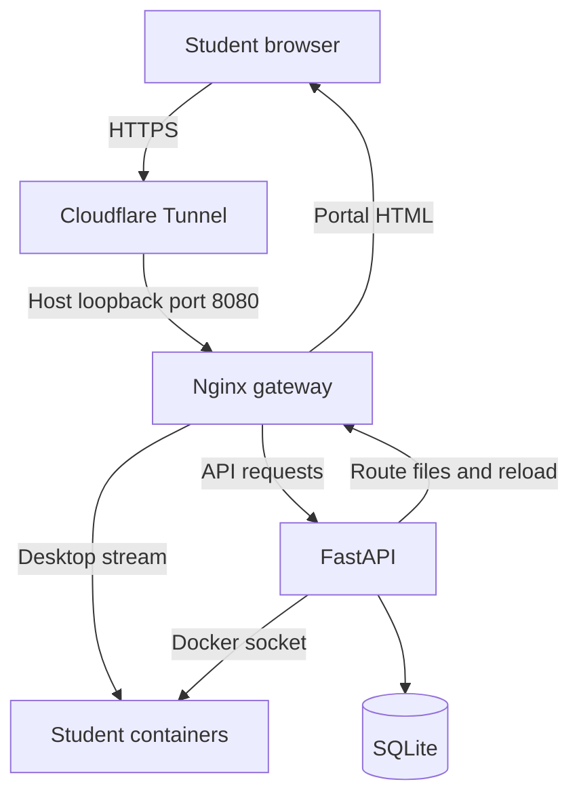

# Browser-based Linux Practice Lab

An on-demand Linux desktop lab for students, hosted on a Raspberry Pi or a Linux server. Students enter a class code, receive a temporary desktop, practise through their browser, and submit feedback when the session ends.

**Status:** the maintainer has verified the current application on Raspberry Pi. EC2 instructions are a deployment guide, not an EC2 benchmark or a claim of a completed cloud deployment.

Each student environment is a **Docker container**, not a separate virtual machine. On EC2, one AWS virtual machine hosts Docker and the student containers. The current frontend is plain HTML, CSS and JavaScript in `backend/frontend/index.html`; it does not require React or Node.js to deploy.

## Multiple colleges and classrooms

Register colleges, versioned lab templates and classrooms through the operator CLI. Each classroom has its own private code, duration and slot cap. See [setup and upgrade commands](docs/classrooms.md). Identity-based membership and an admin dashboard remain future work.

## Features

- Multiple classroom codes with per-classroom limits and a shared host cap (default: four).
- One temporary desktop per session with generated ID and password.
- Loading screen, motivational thoughts every ten seconds, readiness checks and a manual preview fallback.
- New-session timers start after desktop-picture detection and activation.
- Remaining-time display, End Lab, fullscreen and reconnect controls.
- Resume an existing lab using its session ID and password; original expiry remains unchanged.
- Inactivity warning after three minutes and termination after four minutes, subject to polling and installer checks.
- Feedback after manual termination, expiry or inactivity cleanup.
- SQLite session/feedback records and per-session Nginx routing.

## Architecture



The tunnel connector runs on the host. Only Nginx is published, at `127.0.0.1:8080`. Student ports and the API port are not published directly.

## Basic host configuration

These are suggested starting configurations for validation, not measured concurrency guarantees.

| Environment | Suggested starting point | Initial session cap | Notes |
|---|---|---|---|
| Small Pi experiment | Pi 4/5, 4 GB RAM, 64-bit Raspberry Pi OS Lite, 32 GB+ storage | 1–2 | Prefer SSD, reliable power, cooling and Ethernet |
| Pi classroom pilot | Pi 5, 8 GB RAM, SSD 64 GB+, active cooling | 4 | Benchmark the actual exercises before increasing |
| EC2 small pilot | Ubuntu Server 24.04 LTS, 4 vCPU, 8–16 GiB RAM, 40 GB+ encrypted gp3 EBS | 4 | Choose amd64 or ARM64 consistently with the desktop image |

Defaults per student: 768 MiB memory limit, 0.75 CPU quota, 256 processes, 256 MiB shared-memory capacity and a 300 MiB `/config` tmpfs. The shared-memory/tmpfs capacities are not separate RAM reservations; their usage contributes to memory pressure. API and proxy limits are 256 MiB and 128 MiB. Classroom templates can override student resource limits through the operator CLI; API/proxy limits remain in Compose.

## Quick start

1. Prepare Docker Engine and the Compose plugin: [Raspberry Pi](docs/raspberry-pi.md) or [EC2](docs/ec2.md).
2. Obtain the student image using [the image guide](docs/student-image.md). The exact custom image recipe was not included in the source upload.
3. Clone this repository and configure the backend:

```bash
git clone https://github.com/weatcuriosity123/Virtual_Lab_Setup.git
cd Virtual_Lab_Setup/backend
cp .env.example .env
nano .env
mkdir -p data nginx/sessions
chmod 600 .env
docker image inspect linux-lab:1.0 --format '{{.Os}}/{{.Architecture}}'
docker compose up -d --build
docker compose restart proxy
curl --fail http://127.0.0.1:8080/api/health
```

Set a private `CLASS_ACCESS_CODE` and your HTTPS `PUBLIC_BASE_URL` in `.env`. The proxy restart also refreshes its API hostname resolution after an API container replacement.

4. Route your HTTPS hostname to `http://127.0.0.1:8080` using [Cloudflare Tunnel](docs/cloudflare.md).
5. Open the root hostname, enter the class code, retain your session credentials and sign into the desktop if prompted. Start/resume through the portal, not a bare `/s/...` link: the portal handles activation and activity tracking.

Do not run a second copy beside the working installation on the same host: container names, network and loopback port are fixed. For an existing Pi deployment, preserve its `.env`, database and route directory; see [operations](docs/operations.md).

## Configuration

| Variable | Default/example | Purpose |
|---|---|---|
| `CLASS_ACCESS_CODE` | Optional legacy code | Existing admission code during migration |
| `ALLOW_LEGACY_CLASS_CODE` | `true` | Set `false` to admit through classroom codes only |
| `PUBLIC_BASE_URL` | `https://lab.example.com` in example | Public portal origin |
| `SESSION_MINUTES` | `60` | Active-session duration |
| `MAX_SESSIONS` | `4` | Starting + active session limit |
| `STUDENT_IMAGE` | `linux-lab:1.0` | Local desktop image tag |
| `DOCKER_NETWORK` | `linux-lab-net` | Must match the Compose network name |

Compose supplies `SESSION_DB`, `SESSION_CONFIG_DIR` and `PROXY_CONTAINER`. Keep their existing volume/container mapping unless changing the deployment deliberately.

To change the class code, edit `.env`, then run:

```bash
docker compose up -d --force-recreate api
docker compose restart proxy
```

Existing desktop credentials remain valid. Multiple classroom codes, names and expiry can now be managed through the [backend CLI](docs/classrooms.md). A web admin dashboard is future work.

## Repository guide

| Path | Contents |
|---|---|
| `backend/classrooms.py` | College/template/classroom database and local operator commands |
| `backend/main.py` | Session creation, Docker lifecycle, auth, expiry, readiness, inactivity and feedback |
| `backend/frontend/index.html` | Landing page, desktop wrapper, resume and feedback UI |
| `backend/Dockerfile` | API container build |
| `backend/docker-compose.yml` | API, proxy, mounts and network |
| `backend/nginx/default.conf` | Portal and API gateway plus generated desktop routes |
| `backend/.env.example` | Configuration template without real secrets |
| `student-image/Dockerfile` | Optional starter image recipe; not the maintainer's original custom build |
| `docs/` | Deployment, image transfer, operations, API, testing and scaling |
| `cloudflare/config.example.yml` | Host-side tunnel example |
| `tests/test_lifecycle.py` | Mocked Docker lifecycle regression tests |
| `scripts/check.sh` | Local Python, JavaScript and regression checks |

## Session lifecycle

`starting → active → expired/terminated`

Starting sessions reserve capacity for up to five minutes. HTTP readiness is checked before iframe loading. Two desktop-picture checks (or explicit manual confirmation) request activation. Picture detection is a browser heuristic, not an official Selkies first-frame event. Activation starts the usage deadline and inactivity record. Repeated activation does not extend expiry. Timed-out start requests can be retried in the same tab with the same request ID.

Expiry is checked every 15 seconds; inactivity every 10 seconds. Network outages do not pause an active session. The installer-process exemption delays idle cleanup, but not the absolute session deadline. `/config` is temporary; students must export work before ending a lab.

## Scaling and limitations

See [scaling](docs/scaling.md) for sizing, measurements and a multi-host roadmap. **Do not increase Uvicorn workers or replicate this API as a scaling shortcut.** Its admission lock is process-local and it controls one Docker host with local SQLite and route files.

This is a classroom prototype, not a hardened hostile-code sandbox. Containers share the host kernel and Docker bridge; the API has host Docker-socket access. See [operations and security](docs/operations.md) before wider deployment. There is no admin console, HA scheduler, fleet autoscaling or durable student home storage in this version.

## Validation

The working Pi behaviour was confirmed by the maintainer. Automated checks mock Docker; they cannot verify browser streaming or cloud capacity. See [testing](docs/testing.md) for commands and live acceptance checks.

## Repository history

The branches present during this update were `main`, `Sandbox` and `Hosting-VM-On-URL`. Earlier branches document the single-desktop/tunnel experiments. This version records the later multi-session application. Existing branches and history are retained; branch names describe work, not individual team members.

## References

- [Docker Engine installation](https://docs.docker.com/engine/install/)
- [LinuxServer Webtop](https://docs.linuxserver.io/images/docker-webtop/)
- [Cloudflare Tunnel](https://developers.cloudflare.com/cloudflare-one/networks/connectors/cloudflare-tunnel/)
- [EC2 security groups](https://docs.aws.amazon.com/AWSEC2/latest/UserGuide/ec2-security-groups.html)

No project license has been selected in this update. Third-party components retain their own licenses.
